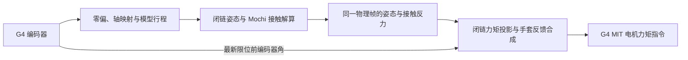

# MotorHand VE33 力反馈需求与当前进展

## 用户需求

- 真机编码器持续提供运动输入。SuperDex 先求解虚拟手与物体的接触、运动和形变，再把同一物理帧的手指姿态和受力用于手套反馈。接触发生后，继续合手仍能挤压可变形物体；虚拟指节的推进由物理解算决定。
- 本地抓握使用固定腕部，支持掌心和桌面。与 Quest 魔方「自由抓取」共用真实接触力的投影和 G4 力矩合成。本地场景提供基础软硬物体和 17 个 SuperDex 官方预制件。
- 接触投影按其原有物理量级进入手套控制，力的量级在仿真源头标定。**稳定受阻时名义力矩超过 5 N·m** 是用户提出的手感目标。轻触、挤压、稳态握持和回撤应各自体现该次物理交互的结果。
- 回撤时用最新编码器核对旧帧继续出力的依据，压低滞后反力，并在新帧跟上后限速恢复。标定和佩戴验收期间，真机会话以预览模式启动。录制需要保留同一控制周期的编码器角、仿真角、反力投影、电机指令和回报电流。

## 当前运行链路



1. **采集和仿真。** 主机目标周期为 100 Hz。仿真步长为 1/240 s，自由抓取和本地抓握在每个子步读取最新目标，每轮在结束子步后发布接触帧。该帧带有解算时用的模型角、限位前的编码器角、实际仿真指节角和接触力矩。
2. **力矩投影。** 以参与传力的手指连杆合力和绕质心力矩计算虚功，先经过连杆雅可比，再经过闭链导数，得到 J1–J12 的接触投影。腕部掌板的合力在场景诊断中显示。
3. **手套侧合成。** 接触投影在 0.01–0.03 N·m 内平滑渐入，同向角差补偿最多 2 N·m/轴。用同一坐标系的当前和同帧限位前编码器角判断回撤，在 1°–3° 内衰减旧帧力矩。编码器速度也使用限位前角，仿真驱动仍依据行程内模型角。合成采用 25 Hz 滤波、60 N·m/s 建力斜率和 0.15 s 启用渐入。
4. **执行和回读。** G4 MIT 使用逐轴前馈力矩，位置和速度增益为零，限幅为 ±9.5 N·m，指令有效期为 100 ms，从所用最旧样本起算。过期和失去接触会卸力。预览状态计算名义值并跳过非零输出。

本地抓握默认使用独立 C++ 控制线程读取 G4、计算闭链姿态、合成和提交电机指令。Mochi 场景所属进程执行 C++ 物理子步、接触采样及闭链投影，通过单写者共享快照和控制线程交换带时戳的数据。Python 从周期快照读出网页和 CSV 所需字段。Quest 自由抓取和显式选择的 Python 后端沿用参考合成器。

本地换物、重建或复位时会生成新的接触场景版本。控制进程在收到新版本后主动卸力，等与新版本匹配的接触帧稳定后再渐入。过渡期间录制保留编码器数据，物理反力和仿真角等字段留空。

| 网页或 CSV 字段 | 含义 |
|---|---|
| `encoder_rad` / `input_rad` | 当前编码器换算角和行程内仿真输入角 |
| `contact_encoder_rad` / `contact_input_rad` | 生成该接触帧时使用的对应角度 |
| `sim_rad` | 接触帧里物理解算后的电机轴角 |
| `contact_motor_nm` / `position_motor_nm` | 原始仿真接触投影和同向位置补偿 |
| `nominal_nm` / `sent_motor_nm` / `current_a` | 合成名义力矩、下发指令和驱动器回报电流 |
| `contact_ms` | 当前接触帧所用最旧输入的年龄 |

## 已验证与待完成

| 项目 | 当前证据 |
|---|---|
| 输入对齐 | 真机通过 12 轴静止窗口标零，编码器与新零位最大偏差约 0.00025°。 |
| 数值投影 | 在虚拟食指中段施加已知 10 N 载荷时，J5 投影约 0.507 N·m。各轴与虚功差分对照的最大绝对误差约 0.00009 N·m。 |
| 真机出力参考 | 旧录制中同一魔方工况的 J5 稳定按压点为 5.33 N·m 和 8.32 N·m，驱动器分别回报约 1.07 A 和 1.67 A。它们提供手感出力的对照值。 |
| 无倍率反力尺度 | 89 mm 硬方块真机预览录制的接触投影峰值为 0.348 N·m，名义力矩峰值为 2.79 N·m。另一段 1 倍真机录制的下发峰值为 3.03 N·m。 |
| 回撤时序 | 录制中有真实编码器回撤而模型角卡在限位的情况。用时间戳重建同帧样本后，代表性的 J10 帧从 1.29 N·m 降到 0。新版在 CSV 中直接保存这两个编码器角。 |
| 仿真力标定 | 对同一条编码器轨迹扫描了虚拟手指刚度、手与魔方的接触刚度和魔方固定支撑刚度。J5 的接触投影中位数仍约为 0.10–0.14 N·m。同一物体、姿态和压缩量下的独立真实载荷还待取得。 |

当前可验收的内容包括编码器和投影链路、挤压形变、回撤衰减、数据记录及指令保护。**仿真力源的物理标定和稳态 5 N·m 手感仍待闭环验收。** 测量时对齐真实载荷的大小、方向、作用点、手部姿态和压缩量，用相同条件复算仿真，再分别检查物理量级与佩戴手感。记录中的下发指令和驱动电流用于验收手套响应。

## 本地复现

无串口演示和真机预览均从仓库根目录启动。构建方式见 [12-DOF G4 驱动 README](../hardware/encos_g4_gateway_12dof/README.md) 与 [16-DOF G4 驱动 README](../hardware/encos_g4_gateway_16dof/README.md)。

```bash
.venv/bin/python tools/ve33_g4_view.py --local-grasp --demo --quest-port 8766
.venv/bin/python tools/ve33_g4_view.py --local-grasp --port /dev/ttyUSB0 --preview --quest-port 8767
OPENBLAS_NUM_THREADS=1 .venv/bin/python -m unittest discover -s tools/tests -q
```
